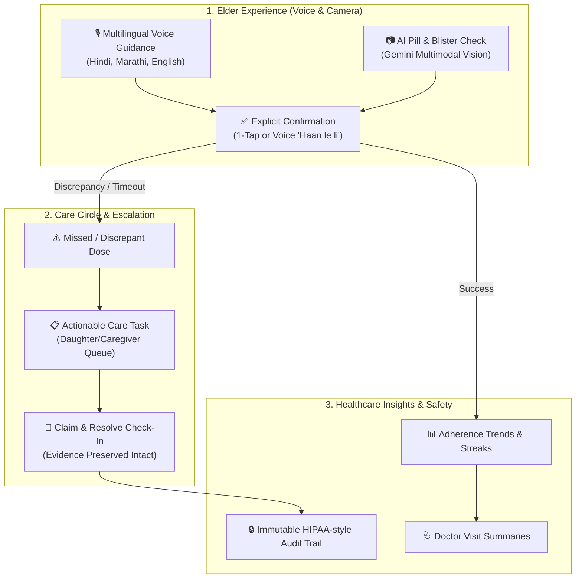

# 🌿 SAATHI
### Care That Stays Close, Even When Family Lives Far Away.

**An AI-Powered, Voice-First Elderly Care & Medication Coordination Platform**  
*Built for PromptWars × Catalyst — Elderly Care & Medication Management Challenge*

---

## 🎯 The Problem

Elderly individuals face compounding challenges managing chronic medications:
- **Polypharmacy & Confusion**: Multiple prescriptions, varying dosages, and confusing pill shapes/colors.
- **Visual & Cognitive Barriers**: Small printed labels, complex app menus, and declining memory.
- **Family Distance Anxiety**: Adult children living in different cities constantly worry (*"Did Papa take his morning BP medicine?"*).
- **Broken Reminder Systems**: Existing apps only ring alarms; when an elder ignores or dismisses a reminder, **nobody follows up**.

> **Our Mission:** Better elderly care isn't about sending more buzzer reminders. It's about making sure someone is there when help is needed.

---

## 💡 The Solution: 3-Pillar Care Ecosystem

SAATHI connects three vital participants:
1. **The Older Adult**: Interacts through natural voice in their native language (Hindi, Marathi, English) and gets AI camera pill safety checks.
2. **The Care Circle (Family & Caregivers)**: Designated caregivers and family members receive actionable tasks when a dose is missed or discrepant.
3. **The Healthcare Provider**: Receives clean, un-tampered adherence data and visit summaries for medical follow-ups.

---

## ✨ Key Capabilities



### 1. 🎙️ Voice-First & Multilingual Accessibility (Module 4)
- Natural audio reminders in Indian languages: Hindi, Marathi, English, and Hinglish.
- Spoken confirmation flow: Saathi repeats the exact medicine and dose for verbal confirmation (*"Aapne Amlodipine 5mg le li?"*).
- Confused or uncertain responses route automatically to the Care Circle.

### 2. 📷 AI Pill & Prescription Verification (Module 6)
- Powered by Google Gemini multimodal vision.
- Scans paper prescriptions, blister packs, and loose pills to verify drug name, dosage, and expiry.
- **Safety Gate**: Warns immediately if the wrong medication is picked up (e.g. evening Metformin in the morning instead of Amlodipine).

### 3. 🤝 Care Circle — From Reminders to Coordinated Care (Module 3)
- When a scheduled dose passes its 1-hour review window or has a reported discrepancy, SAATHI automatically opens an **Escalation Task**.
- Eligible caregivers receive instant alerts, claim the task, call the elder, and record check-in outcomes (`checked_in`, `referred_for_review`, or `unable_to_reach`).
- **Evidence Integrity**: Resolving a task records care intervention without faking or overwriting actual dose intake data.
- **Unresolved Filter**: Instant access to active unresolved tasks (`?status=unresolved`).

### 4. 💊 Resilient Medication & Schedule Management (Module 2)
- Time-zone aware scheduling with 14-day rolling materialization.
- Separate, tamper-proof tracking of patient-reported time vs server transaction timestamps.
- Idempotent mutations protected by 24-hour client UUIDv4 keys.

### 5. 📊 Family Insights & Doctor Visit Summaries (Modules 5 & 7)
- Mutual exclusive adherence calculations: `scheduled`, `patient_reported`, `verified`, `needs_review`, `missed`.
- One-click visit summary generation for upcoming doctor appointments.

---

## 📱 Interactive Prototype

Test the live dual-view interactive demonstration:
- **Open [`saathi_hackathon_ui.html`](saathi_hackathon_ui.html)** directly in your browser.
- Experience the side-by-side **Elder View** (large touch targets, voice prompts, pill scanner) and **Caregiver View** (task claims, real-time alerts, adherence scores).

---

## 🏗️ Technical Architecture & Backend Baseline

The backend is built as a cloud-ready, enterprise-grade healthcare API:
- **Framework**: Next.js 16 (App Router / Turbopack), TypeScript 5.9.
- **Security & Database**: Firebase Authentication (ID Token verification), Cloud Firestore with strict security rules, Cloud Functions (Pub/Sub & Scheduler).
- **AI Intelligence**: Gemini 1.5/2.0 multimodal document and vision extraction with human-in-the-loop candidate review.
- **Reliability & Idempotency**: Transactional leases, deduplicated Pub/Sub sweeps, and 24-hour cryptographic idempotency keys.
- **API Surface**: 34 authenticated operations + public health check (`/api/v1/health`).

---

## 🧪 Verified Test Suite (14 Passing Tests)

All modules are covered by automated unit, security rule, and end-to-end emulator tests:

```sh
npm test              # 7 unit tests (contracts, time-zone recurrence, schemas)
npm run test:rules    # 2 Firestore client security rules tests (Java 25 JBR)
npm run test:backend  # 5 backend emulator tests (gating, Care Circle escalation, invitation sweep, retries)
npm run lint          # 0 ESLint warnings
npm run typecheck     # 0 TypeScript errors
npm run build         # Next.js 16 production build succeeded
npm --prefix functions run build # Cloud Functions compilation succeeded
```

---

## ⚙️ Local Development Quickstart

### Prerequisites
- Node.js 22 LTS or Node.js 24
- Java 21 or Java 25 (for Firestore local emulator)
- Firebase CLI (`firebase-tools`)

### 1. Clone & Install
```bash
git clone https://github.com/Atharva486dherange/catalyst-.git
cd catalyst-
npm ci
npm --prefix functions ci
```

### 2. Environment Setup
Copy `.env.example` to `.env.local`:
```bash
node -e "console.log(require('node:crypto').randomBytes(32).toString('base64'))"
# Place the generated base64 string in INVITATION_ENCRYPTION_KEY inside .env.local
```

### 3. Run Local Emulators & Dev Server
```bash
# Terminal 1: Start Auth & Firestore Emulators
npm run emulators

# Terminal 2: Start Next.js Development Server
npm run dev
```

- Public Health Check: `http://localhost:3000/api/v1/health`
- Firebase Emulator Suite UI: `http://127.0.0.1:4000`

---

## ☁️ Hosted Deployment Setup

Follow the deployment checklist for Google Cloud & Firebase:
1. **Firestore**: Deploy rules and composite indexes:
   ```bash
   npx firebase deploy --only firestore:rules,firestore:indexes --project YOUR_PROJECT_ID
   ```
2. **App Hosting**: Connect GitHub repository to Firebase App Hosting. Set server runtime secrets (`GEMINI_API_KEY`, `INVITATION_ENCRYPTION_KEY`).
3. **Cloud Functions & Scheduler**: Deploy scheduled sweep workers:
   ```bash
   npx firebase deploy --only functions --project YOUR_PROJECT_ID
   ```
4. **Resend Email & Gemini**: Provide runtime secret keys in Google Secret Manager to enable live delivery and vision extraction.

---

## 📚 Project Documentation & References

- [HTTP API Contract](docs/API_CONTRACT.md) — Schemas and endpoints for all 34 operations.
- [Architecture & Boundaries](docs/ARCHITECTURE.md) — Transaction boundaries and concurrency design.
- [Build Status](docs/BUILD_STATUS.md) — Current implementation and test coverage.
- [Backend Scope & Roadmap Handoff](docs/BUILD_STATUS.md) — Submission status and future module sequence.

---

## 👥 Team

**Team Name:** THE SHADOW MAN  
**Team Member:** Atharva Balasaheb Dherange  
**Event:** PromptWars × Catalyst  
**Challenge:** Elderly Care & Medication Management Platform  

---

<p align="center">
  <b>SAATHI — Care That Stays Close.</b><br/>
  <i>Making elderly care simpler, safer, and deeply human.</i>
</p>
